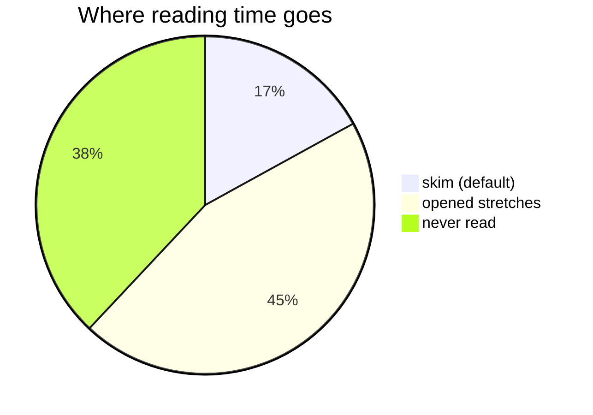
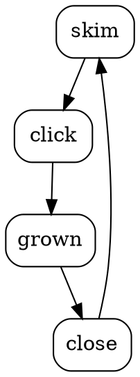
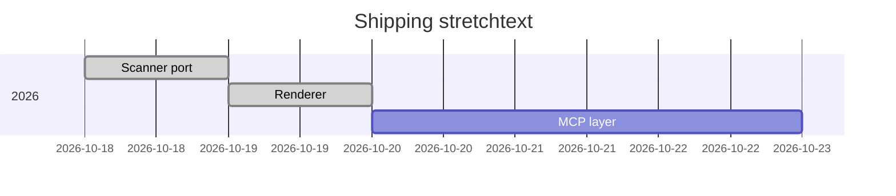

# Demo

Everything the renderer can do, in one page.

## Nesting

{{A budget is a plan for money.|A budget is a plan for money over a period: {{money coming in|money coming in, mostly wages for most households}} minus {{money going out|money going out: fixed costs like rent and utilities, plus variable costs like food}}.}}

## Code never stretches

The markup is inert in code. A fence:

```
greeting = "{{Hello|Hello, and welcome to the whole thing.}}"
```

and a span: `use {{short|long}} sparingly` — both show braces literally.

## Tables

| View | Meaning |
| ---- | ------- |
| {{skim|the skim is the page with every stretch closed}} | default |
| {{read|the read is the page with the stretches you opened grown}} | one click each |

## Lists

- {{List items stretch individually|List items stretch individually, one each, so the list stays visible on screen while one grows — it never jumps to the bottom of a grown paragraph.}}
- {{Markdown keeps working inside a long form|Markdown keeps working inside a long form: **bold**, `code` and [links](https://example.com) are all converted normally.}}

## Diagrams






