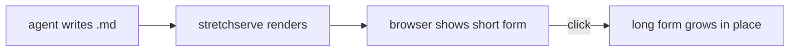
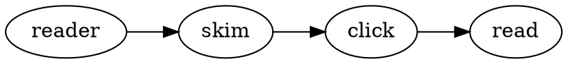

# Authoring stretchable documents

A stretch is written `{{short|long}}`. The reader sees **short**; clicking it grows it into **long**, in place.

The rules, each of which keeps a promise the reader depends on:

- {{The short form answers on its own.|The short form must be a complete thought that answers on its own: anything the reader must decide or do stays outside every stretch, where it is always visible.}}
- {{The long form keeps every word of the short form.|The long form keeps every word of the short form, in the same order, and grows around them — new words appear before, between and after the words already read. On screen the old words never move, so the reader never loses their place.}} The checker enforces this; a violation is an error.
- {{A phrase grows into a clause, a sentence into a paragraph.|The growth is by scale, not by topic: a phrase grows into a clause, a sentence grows into a paragraph, a paragraph grows into several. The long form must read correctly standing exactly where the short form stood.}}
- {{Stretches nest.|A long form may hold further stretches that nest inside it, each a further level of depth. Shift-click opens a stretch and everything inside it at once.}}
- {{Keep the short form plain inline text on one line.|Keep the short form plain inline text on one line: never put a stretch inside a code span, a code block, a table or a heading. The scanner leaves code alone, so braces in code are literal.}}
- {{A long form may grow across blocks.|A long form may grow across blocks — several paragraphs, lists, even fenced code — when the stretch stands on its own line at the top level of the document. A block stretch never starts inside a list, a quote, a table, or another stretch; the checker rejects those placements.}}

Everything else is ordinary markdown, including fenced blocks:

A stretch with no `|` — `{{like this}}` — has nothing to open: the braces vanish and the text is plain. The checker warns about it.
